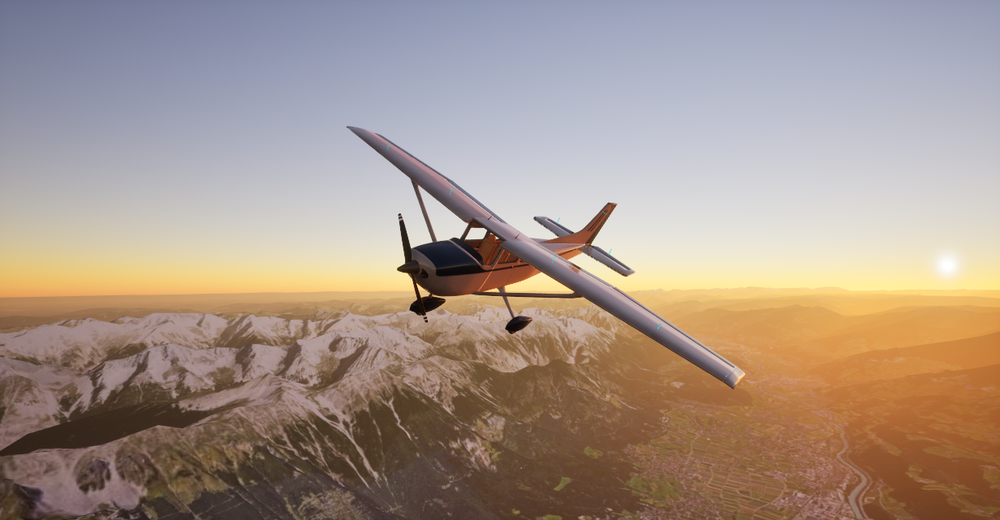

# ✈️ MyWings 2026

\

&#x20; \
\

\<h3 align="center">YOUR FLIGHT. YOUR EXPERIENCE.\</h3>

\
   An independent flight simulator developed by \<strong>Amater Studio\</strong>. \

\
   \<a href="[https://amaterstudio-official.github.io/MyWingsOfficialSite/](https://amaterstudio-official.github.io/MyWingsOfficialSite/)">Official Website\</a>   &nbsp;•&nbsp;   \<a href="[https://github.com/AmaterStudio-Official](https://github.com/AmaterStudio-Official)">GitHub Organization\</a>   &nbsp;•&nbsp;   \<a href="ROADMAP.md">Development Roadmap\</a> \

\

&#x20; \
&#x20; \
&#x20; \
&#x20; \
\

---

## About MyWings 2026

**MyWings 2026** is an independent flight simulator project focused on creating an immersive aviation experience.

Built with **Unreal Engine 5** and **Cesium for Unreal**, the project aims to bring together aircraft flight physics, interactive controls and an expanding world environment.

The goal is to develop a simulator that can grow over time through new aircraft, improved flight systems, environmental updates and additional features.

MyWings 2026 is being developed independently by **Amater Studio**.

## Development Status

\

&#x20; \<strong>PRE-ALPHA DEVELOPMENT\</strong>
\

MyWings 2026 is currently in its early Pre-Alpha stage.

The project already has an initial foundation for aircraft flight, including takeoff, flight and landing mechanics. Development is continuing on the core simulator experience, user interface and world environment.

**The first playable public build is not available yet.**

The simulator is still being developed and tested. Features, systems and planned release milestones may change as development progresses.

---

## Screenshots

A look at the current development of MyWings 2026.

\

&#x20; \
&#x20; &nbsp;
&#x20; \
\

*More screenshots and development previews will be added as the project evolves.*

---

## Core Features

The simulator is being developed around several key areas.

### 🛩️ Aircraft & Flight

- Aircraft flight physics
- Takeoff, flight and landing mechanics
- Aircraft controls
- Further aircraft systems and improvements

### 🌍 World & Environment

- Geographic world integration
- Cesium-powered environment
- Progressive world loading
- Future environment expansion

### 🎮 Simulator Experience

- Main menu and user interface
- Cockpit and external camera views
- Future aircraft instruments and systems
- Continuous improvements to the overall experience

*Some features are still planned or under development and are not necessarily available in the current project.*

---

## Development Roadmap

MyWings 2026 is being developed in stages, from its first Pre-Alpha foundations to a planned full release.

| Version | Milestone                     |
| ------- | ----------------------------- |
| `0.0.1` | First Public Preview          |
| `0.1.0` | First Development Milestone   |
| `0.2.0` | Aircraft Expansion            |
| `0.3.0` | World and Simulator Expansion |
| `0.5.0` | Major Development Update      |
| `0.8.0` | Beta                          |
| `0.9.0` | Release Candidate             |
| `1.0.0` | Official Release              |

These milestones are development targets, not guaranteed release dates.

[**→ Explore the Full Development Roadmap**](ROADMAP.md)

---

## Technology

MyWings 2026 is built with the following technologies:

| Technology                | Purpose                               |
| ------------------------- | ------------------------------------- |
| Unreal Engine 5           | Main game engine                      |
| Cesium for Unreal         | World and geographic integration      |
| C++ / Unreal Engine tools | Simulator development                 |
| GitHub                    | Source code and project documentation |

---

## Project Documentation

Explore the project's development documentation:

| Document                                      | Description                                        |
| --------------------------------------------- | -------------------------------------------------- |
| [Development](DEVELOPMENT.md)                 | Development overview and current priorities        |
| [Roadmap](ROADMAP.md)                         | Planned versions and milestones                    |
| [Changelog](CHANGELOG.md)                     | Development and release history                    |
| [Third-Party Notices](THIRD_PARTY_NOTICES.md) | External technologies and license acknowledgements |
| [License](LICENSE)                            | Licensing information                              |

---

## Follow Development

Follow MyWings 2026 to keep up with its progress.

- **GitHub:** Development updates, project documentation and issue tracking.
- **Official Website:** Information about the project and Amater Studio.
- **GitHub Releases:** Future version announcements and public builds.

\

&#x20; \<a href="[https://github.com/AmaterStudio-Official](https://github.com/AmaterStudio-Official)">Explore Amater Studio on GitHub\</a>
&#x20; &nbsp;•&nbsp;
&#x20; \<a href="[https://amaterstudio-official.github.io/MyWingsOfficialSite/](https://amaterstudio-official.github.io/MyWingsOfficialSite/)">Visit the Official Website\</a>
\

---

## Developer

\

&#x20; \<strong>AMATER STUDIO\</strong>
&#x20; \ 
&#x20; Independent Game Development
\

MyWings 2026 is an independently developed project by Amater Studio.

---

\

&#x20; \<strong>MYWINGS 2026\</strong>
&#x20; \ 
&#x20; \<em>Your Flight. Your Experience.\</em>
\

