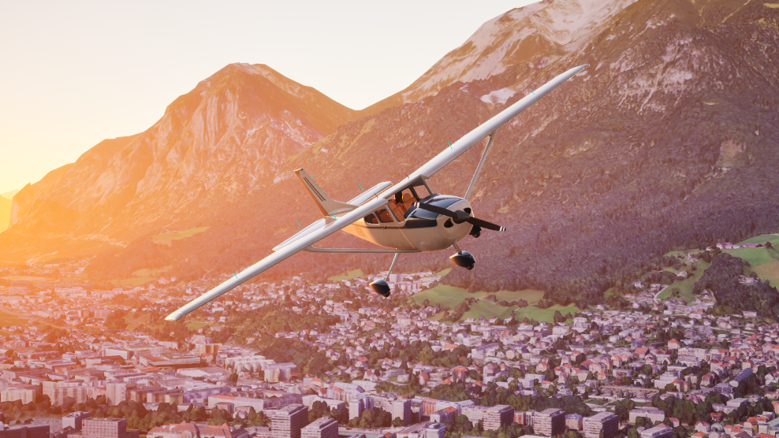

# MyWings 2026

### An Independent Flight Simulator by Amater Studio

**Your Flight. Your Experience.**

  

  <a href="https://amaterstudio-official.github.io/MyWingsOfficialSite/">Official Website</a> ·
  <a href="https://github.com/AmaterStudio-Official">GitHub</a>

---

## Project Status

**MyWings 2026 is currently in development.**

MyWings 2026 is an independent flight simulator project developed by **Amater Studio** using Unreal Engine 5.

The project aims to create an immersive flight simulation experience, combining aircraft flight physics, interactive aircraft systems, cockpit views and an expanding world.

The simulator is currently in early Pre-Alpha development. The first playable public release is not available yet.

---

## About the Project

The goal of MyWings 2026 is to create an independent flight simulator that allows players to experience the world of aviation through interactive aircraft and realistic flight mechanics.

Development focuses on building a solid foundation for future aircraft, environments and simulator systems.

## Planned Features

- Aircraft flight physics
- Aircraft controls and flight mechanics
- Cockpit and external camera views
- Aircraft instruments and systems
- Expanding environments
- Additional aircraft
- Continuous improvements and updates

*Features are planned and may change during development.*

---

## Development Roadmap

Follow the project's development progress and upcoming milestones:

[View the Development Roadmap](ROADMAP.md)

## Screenshots

Screenshots and development previews will be published as development progresses.

  

More media will be available in the `screenshots/` directory.

## Development Updates

Follow the repository for:

- Development announcements
- Progress reports
- New screenshots and videos
- Bug fixes and improvements
- Release announcements

## Official Website

Visit the official MyWings 2026 website:

**https://amaterstudio-official.github.io/MyWingsOfficialSite/**

## Developer

**Amater Studio**

MyWings 2026 is an independent project developed by Amater Studio.

---

**MYWINGS 2026**
 
Your Flight. Your Experience.
  

