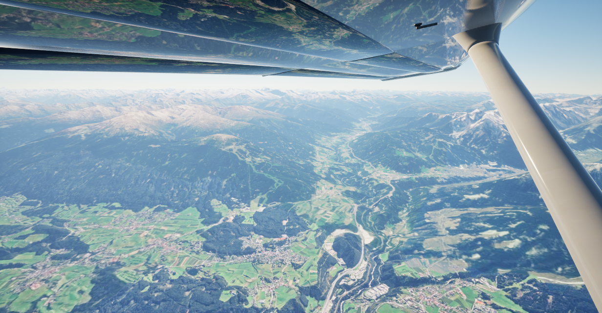

# MyWings 2026

### AN INDEPENDENT FLIGHT SIMULATOR BY AMATER STUDIO

**Your Flight. Your Experience.**

[Official Website](https://amaterstudio-official.github.io/MyWingsOfficialSite/) | [GitHub Organization](https://github.com/AmaterStudio-Official) | [Development Roadmap](ROADMAP.md)

---

## PROJECT OVERVIEW

MyWings 2026 is an independent flight simulator developed by **Amater Studio**.

Built with **Unreal Engine 5** and **Cesium for Unreal**, the project aims to create an immersive aviation experience combining aircraft flight physics, interactive controls and geographic world environments.

The long-term vision is to develop an expanding simulator with new aircraft, improved flight systems and an increasingly detailed world.

---

## DEVELOPMENT STATUS

**EARLY PRE-ALPHA — IN DEVELOPMENT**

MyWings 2026 is currently in active development.

The project already has an initial flight experience featuring basic takeoff, flight and landing mechanics. Development is currently focused on improving the core simulator, completing the startup flow and expanding the overall experience.

**No playable public build is currently available.**

This is an early development project. Features, systems and release plans may change as development progresses.

---

## PROJECT GALLERY

A preview of the current development of MyWings 2026.

---

## SIMULATOR FEATURES

### Aircraft and Flight

- Aircraft flight physics
- Takeoff, flight and landing mechanics
- Aircraft control systems
- Cockpit and external camera perspectives
- Future aircraft and system expansions

### World and Environment

- Geographic world integration
- Cesium-powered environments
- Progressive world loading
- Future environment expansion

### Simulator Experience

- Main menu and user interface
- Aircraft interaction and controls
- Future instruments and aircraft systems
- Performance and stability improvements

*This list includes existing foundations and planned features. Not everything is currently implemented.*

---

## DEVELOPMENT ROADMAP

MyWings 2026 follows a milestone-based development plan.

| VERSION | MILESTONE |
|:---:|---|
| 0.0.1 | First Public Preview |
| 0.1.0 | First Development Milestone |
| 0.2.0 | Aircraft Expansion |
| 0.3.0 | World and Simulator Expansion |
| 0.5.0 | Major Development Update |
| 0.8.0 | Beta |
| 0.9.0 | Release Candidate |
| 1.0.0 | Official Release |

All milestones are development targets and do not represent guaranteed release dates.

**[EXPLORE THE FULL ROADMAP](ROADMAP.md)**

---

## TECHNOLOGY

| TECHNOLOGY | PURPOSE |
|---|---|
| Unreal Engine 5 | Main game engine |
| Cesium for Unreal | Geographic world integration |
| C++ and Unreal Engine tools | Simulator development |
| GitHub | Project documentation and development tracking |

---

## DOCUMENTATION

Explore the development and technical documentation of MyWings 2026.

| DOCUMENT | DESCRIPTION |
|---|---|
| [Development](DEVELOPMENT.md) | Development process and current priorities |
| [Roadmap](ROADMAP.md) | Planned milestones and future versions |
| [Changelog](CHANGELOG.md) | Development and release history |
| [Third-Party Notices](THIRD_PARTY_NOTICES.md) | External technologies and license acknowledgements |
| [License](LICENSE) | Licensing information |

---

## FOLLOW DEVELOPMENT

Follow the project to stay informed about future progress.

- **GitHub:** Development updates, issues and discussions.
- **Official Website:** Project information and Amater Studio.
- **GitHub Releases:** Future announcements and playable builds.

**[VISIT THE OFFICIAL MYWINGS WEBSITE](https://amaterstudio-official.github.io/MyWingsOfficialSite/)**

---

## DEVELOPED BY AMATER STUDIO

MyWings 2026 is an independently developed flight simulator project by **Amater Studio**.

---

**MYWINGS 2026**

*YOUR FLIGHT. YOUR EXPERIENCE.*
